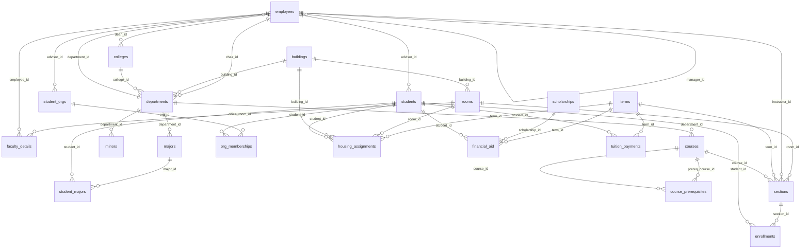

# Dataset schema — fictional Saint Louis University

Generated by `data/generate.py` (seed 42). All people and numbers are fictional.

`terms.term_id` is chronological: consecutive ids are consecutive semesters (no summer terms).
`employees.manager_id` forms a 5-level tree (President → Provost → Dean → Chair → faculty/staff).
`course_prerequisites` contains chains 4 deep (e.g. CSCI Intro → OOP → Data Structures → Algorithms → Compilers).

## Planted features for the problems

- Ties: top GPA is shared by 3 students (4.00) and 3 more share 3.98; salaries are rounded to $1,000 so departments contain ties (Biology's top salary is tied).
- NULLs: ~8% of students have no major, ~10% have no advisor, 13 courses have never been offered, two departments have no employees, the President has no manager, some sections have no instructor.
- Double majors: ~12% of declared students. Enrollment gaps: 45 students skipped a term.
- Capacity: every section whose id is a multiple of 17 is exactly full; multiples of 23 are over capacity.
- Skew: Biology and Computer Science are huge, Classics is tiny.

## ER diagram

## Tables

### colleges  (4 rows)

| column | type | key | nullable |
|---|---|---|---|
| college_id | INTEGER | PK | no |
| name | TEXT |  | no |
| abbreviation | TEXT |  | no |
| founded_year | INTEGER |  | no |
| dean_id | INTEGER | FK → employees.employee_id | yes |

### buildings  (16 rows)

| column | type | key | nullable |
|---|---|---|---|
| building_id | INTEGER | PK | no |
| name | TEXT |  | no |
| abbreviation | TEXT |  | no |
| address | TEXT |  | no |
| year_built | INTEGER |  | no |
| building_type | TEXT |  | no |

### departments  (24 rows)

| column | type | key | nullable |
|---|---|---|---|
| department_id | INTEGER | PK | no |
| college_id | INTEGER | FK → colleges.college_id | no |
| name | TEXT |  | no |
| code | TEXT |  | no |
| building_id | INTEGER | FK → buildings.building_id | yes |
| chair_id | INTEGER | FK → employees.employee_id | yes |

### rooms  (332 rows)

| column | type | key | nullable |
|---|---|---|---|
| room_id | INTEGER | PK | no |
| building_id | INTEGER | FK → buildings.building_id | no |
| room_number | TEXT |  | no |
| capacity | INTEGER |  | no |
| room_type | TEXT |  | no |

### employees  (179 rows)

| column | type | key | nullable |
|---|---|---|---|
| employee_id | INTEGER | PK | no |
| first_name | TEXT |  | no |
| last_name | TEXT |  | no |
| email | TEXT |  | no |
| title | TEXT |  | no |
| department_id | INTEGER | FK → departments.department_id | yes |
| manager_id | INTEGER | FK → employees.employee_id | yes |
| salary | INTEGER |  | no |
| hire_date | TEXT |  | no |
| employee_type | TEXT |  | no |
| status | TEXT |  | no |

### faculty_details  (143 rows)

| column | type | key | nullable |
|---|---|---|---|
| employee_id | INTEGER | PK | no |
| rank | TEXT |  | no |
| tenure_status | TEXT |  | no |
| office_room_id | INTEGER | FK → rooms.room_id | yes |
| phd_year | INTEGER |  | yes |

### majors  (31 rows)

| column | type | key | nullable |
|---|---|---|---|
| major_id | INTEGER | PK | no |
| department_id | INTEGER | FK → departments.department_id | no |
| name | TEXT |  | no |
| degree | TEXT |  | no |
| total_credits | INTEGER |  | no |

### minors  (10 rows)

| column | type | key | nullable |
|---|---|---|---|
| minor_id | INTEGER | PK | no |
| department_id | INTEGER | FK → departments.department_id | no |
| name | TEXT |  | no |

### students  (500 rows)

| column | type | key | nullable |
|---|---|---|---|
| student_id | INTEGER | PK | no |
| first_name | TEXT |  | no |
| last_name | TEXT |  | no |
| email | TEXT |  | no |
| birth_date | TEXT |  | no |
| home_state | TEXT |  | no |
| home_city | TEXT |  | no |
| enrollment_year | INTEGER |  | no |
| gpa | REAL |  | yes |
| advisor_id | INTEGER | FK → employees.employee_id | yes |
| status | TEXT |  | no |

### student_majors  (519 rows)

| column | type | key | nullable |
|---|---|---|---|
| student_id | INTEGER | PK | no |
| major_id | INTEGER | PK | no |
| is_primary | INTEGER |  | no |
| declared_on | TEXT |  | no |

### terms  (6 rows)

| column | type | key | nullable |
|---|---|---|---|
| term_id | INTEGER | PK | no |
| name | TEXT |  | no |
| year | INTEGER |  | no |
| season | TEXT |  | no |
| start_date | TEXT |  | no |
| end_date | TEXT |  | no |

### courses  (136 rows)

| column | type | key | nullable |
|---|---|---|---|
| course_id | INTEGER | PK | no |
| department_id | INTEGER | FK → departments.department_id | no |
| course_code | TEXT |  | no |
| title | TEXT |  | no |
| credits | INTEGER |  | no |
| level | INTEGER |  | no |

### course_prerequisites  (58 rows)

| column | type | key | nullable |
|---|---|---|---|
| course_id | INTEGER | PK | no |
| prereq_course_id | INTEGER | PK | no |
| min_grade | TEXT |  | no |

### sections  (753 rows)

| column | type | key | nullable |
|---|---|---|---|
| section_id | INTEGER | PK | no |
| course_id | INTEGER | FK → courses.course_id | no |
| term_id | INTEGER | FK → terms.term_id | no |
| instructor_id | INTEGER | FK → employees.employee_id | yes |
| room_id | INTEGER | FK → rooms.room_id | yes |
| section_number | TEXT |  | no |
| meeting_days | TEXT |  | no |
| start_time | TEXT |  | no |
| end_time | TEXT |  | no |
| capacity | INTEGER |  | no |

### enrollments  (7503 rows)

| column | type | key | nullable |
|---|---|---|---|
| enrollment_id | INTEGER | PK | no |
| student_id | INTEGER | FK → students.student_id | no |
| section_id | INTEGER | FK → sections.section_id | no |
| enrolled_on | TEXT |  | no |
| status | TEXT |  | no |
| grade | TEXT |  | yes |
| grade_points | REAL |  | yes |

### student_orgs  (25 rows)

| column | type | key | nullable |
|---|---|---|---|
| org_id | INTEGER | PK | no |
| name | TEXT |  | no |
| category | TEXT |  | no |
| advisor_id | INTEGER | FK → employees.employee_id | yes |
| founded_year | INTEGER |  | no |

### org_memberships  (395 rows)

| column | type | key | nullable |
|---|---|---|---|
| student_id | INTEGER | PK | no |
| org_id | INTEGER | PK | no |
| role | TEXT |  | no |
| joined_on | TEXT |  | no |

### housing_assignments  (403 rows)

| column | type | key | nullable |
|---|---|---|---|
| assignment_id | INTEGER | PK | no |
| student_id | INTEGER | FK → students.student_id | no |
| building_id | INTEGER | FK → buildings.building_id | no |
| room_id | INTEGER | FK → rooms.room_id | no |
| term_id | INTEGER | FK → terms.term_id | no |
| rate | INTEGER |  | no |

### scholarships  (10 rows)

| column | type | key | nullable |
|---|---|---|---|
| scholarship_id | INTEGER | PK | no |
| name | TEXT |  | no |
| sponsor | TEXT |  | no |
| amount | INTEGER |  | no |
| min_gpa | REAL |  | yes |
| is_need_based | INTEGER |  | no |

### financial_aid  (910 rows)

| column | type | key | nullable |
|---|---|---|---|
| aid_id | INTEGER | PK | no |
| student_id | INTEGER | FK → students.student_id | no |
| scholarship_id | INTEGER | FK → scholarships.scholarship_id | no |
| term_id | INTEGER | FK → terms.term_id | no |
| amount | INTEGER |  | no |

### tuition_payments  (3889 rows)

| column | type | key | nullable |
|---|---|---|---|
| payment_id | INTEGER | PK | no |
| student_id | INTEGER | FK → students.student_id | no |
| term_id | INTEGER | FK → terms.term_id | no |
| amount | REAL |  | no |
| paid_on | TEXT |  | no |
| method | TEXT |  | no |
| status | TEXT |  | no |
